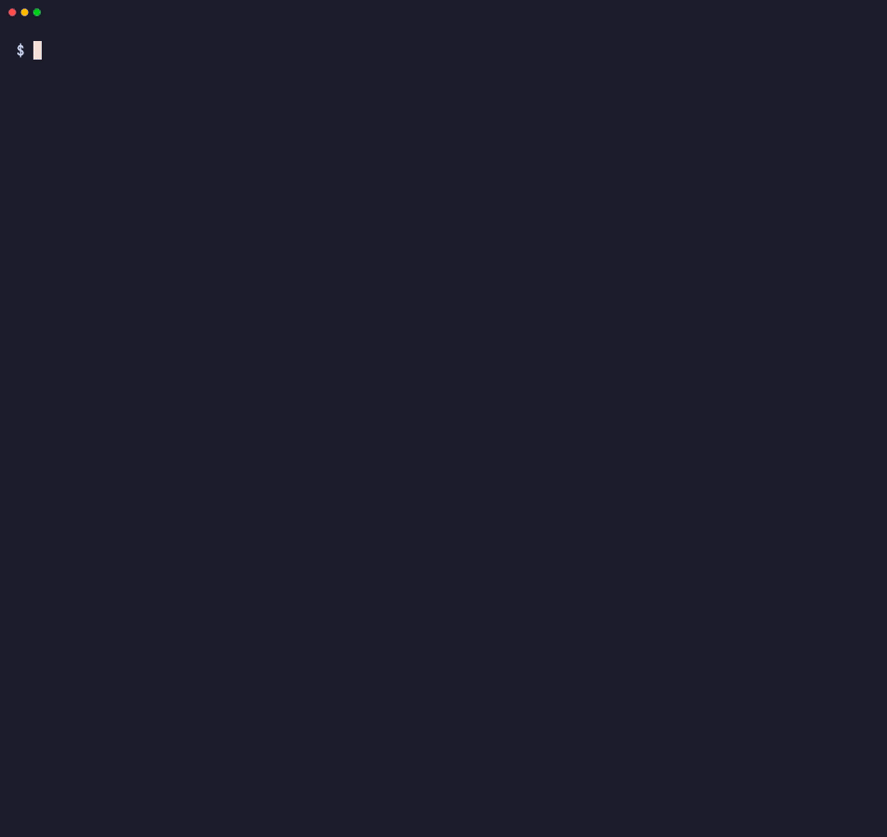

<div align="center">

# heldkeys

**Which keys is your agent holding?**

If a prompt injection hijacked the AI agent running here, which credentials could it use?<br>
heldkeys lists them for your terminal, the agent's sandbox or the CI job, without printing a single secret.

[](https://github.com/hugomn/heldkeys/actions/workflows/ci.yml)
[](https://crates.io/crates/heldkeys)
[](LICENSE)
[](#what-heldkeys-never-does)

</div>

<p align="center">
  
</p>

**What it finds**

- **Credentials on your machine an agent inherits:** environment variables, cloud CLI logins (AWS, gcloud, Azure, kubeconfig), AI tool logins (Codex, Claude Code, Gemini CLI, Copilot, Hugging Face), developer platform CLI logins (Vault, Terraform, Vercel, Netlify, Fly.io, Supabase, Wrangler, Stripe, Doppler, Railway, Kaggle), package and git tokens, `.env` files and their editor history copies, SSH keys, and tokens pasted into MCP server configs.
- **AI agent risks in GitHub Actions:** agent steps on triggers anyone can fire, agents working in a fork's checkout, write tokens, extra secrets, unpinned agent actions and unrestricted shell, followed through local reusable workflows.
- **What a sandbox or CI job really exposes:** the Docker socket, a Kubernetes service account token, the cloud metadata endpoint, OIDC, and the job's own tokens, checked from inside.

```sh
brew install hugomn/tap/heldkeys
heldkeys
```

A single self-contained binary for Linux and macOS: read-only, no telemetry, done in well under a second. Other install methods are [below](#install).

## What heldkeys never does

> [!IMPORTANT]
> - Never prints a secret. Values appear only as fingerprints such as `AKIA…PLE`, and only for token formats whose prefix is public. Passwords and tokens of unknown shape get no fingerprint at all. A test runs every fixture through every output format, on stdout, stderr and `--output` files, and fails if any 10-character slice of a fixture secret appears anywhere.
> - Never sends your data anywhere. No telemetry, no update checks, no crash reports. `--deep` is reserved for future checks that ask a credential's own issuer about it; today it does nothing.
> - Never writes to your machine. It reads files and the environment and reports. The only files it creates are the ones you name with `--output` or `--write-baseline`.
>
> Outside its own process it touches only these things:
>
> - `ssh-add -l`, with nothing but `SSH_AUTH_SOCK` and `PATH` in its environment, to list the public fingerprints of keys loaded in your SSH agent.
> - Each Docker socket it finds: it connects and closes again, sending nothing.
> - `169.254.169.254:80`: one TCP connect with a 300 ms timeout and no payload, to see whether a cloud metadata service is reachable. `HELDKEYS_NO_NET=1` turns it off.
> - `git ls-files`, only with `ci --repo-secrets`, with a cleared environment and hooks disabled.
> - `docker` or `kubectl`, only with `scan --docker <container>` or `scan --kube <pod>`, to copy the binary to `/tmp` in that target and run it there. The copy deletes its own file as soon as it starts, and heldkeys runs `rm -f` on it afterwards in case it never started; [docs/sandboxes.md](docs/sandboxes.md#what-happens-to-the-copy) lists the cases where it can still be left behind.
>
> Of an SSH private key file it reads only the first 256 bytes, enough for the header and the cipher name, and keeps nothing from them.
>
> Beyond that it needs no runtime, no daemon, no config file (an optional `.heldkeys.toml` only lists accepted risks), no `$HOME`. It works on a read-only filesystem, and the prebuilt Linux binaries are static (musl), so you can copy one into any container.

What it defends against, and what it cannot see, is in the [threat model](docs/threat-model.md).

## Why I built this

I run coding agents on my laptop every day, and at some point I asked what one of them could use if a prompt injection talked it into running a command. I couldn't find a tool that answered it. Secret scanners look for secrets committed to a repository. I wanted to know what a process running as me could use right now.

So I built heldkeys and ran it on my own machine first. It found the usual things that build up over the years: an old plaintext git credentials file, a token exported in my shell profile, SSH keys without a passphrase. Every agent I started could have used them. Cleaning them up took about twenty minutes.

## Local

Run it in the same terminal your agent uses (Claude Code, Codex, Cursor, Aider), because that is the environment the agent inherits. Here is a scan of a test home built from the fake fixtures in this repository, with two tokens exported in the shell, one of them also pasted into a Cursor MCP config (the same setup `demo.tape` records):

```text
$ heldkeys
heldkeys: 13 credentials reachable from ~/code/app (7 long-lived with write access)

Fix these first
  HIGH    Anthropic API key                     env: ANTHROPIC_API_KEY                  sk-a…AKE
  HIGH    GitHub OAuth token                    ~/.config/gh/hosts.yml (github.com)     gho_…013
  HIGH    Docker registry credentials           ~/.docker/config.json (htt…ker.io/v1/)
  HIGH    npm access token                      ~/.npmrc (//registry.npmjs.org/)        npm_…010
  HIGH    GitHub personal access token          env: GITHUB_TOKEN                       ghp_…021  ×2
  HIGH    Long-lived AWS access key             ~/.aws/credentials [default]            AKIA…PLE
  HIGH    Google ADC user refresh token         ~/.config/gc…_default_credentials.json
  HIGH    SSH private key without a passphrase  ~/.ssh/id_ed25519
  HIGH    Connection string with embedded…      ./.env: DATABASE_URL
  HIGH    OpenAI project API key                ./.env: OPENAI_API_KEY                  sk-p…015
  +2 more credentials, see --details

Where they are                                     high  medium     low
  Shell environment                                   2       -       -
  Cloud CLIs (AWS, gcloud, Azure, kube)               2       1       -
  Git and GitHub                                      1       -       -
  Package registries (npm, PyPI, cargo, Docker)       2       -       -
  SSH                                                 1       -       -
  MCP and agent configs                               1       -       -
  Project .env files                                  2       -       1  3 in 2 files

Same secret in several places
  GitHub personal access token (classic) ghp_…021 in 2 places (env: GITHUB_TOKEN, +1)

Next steps
  1. Move secrets out of 2 .env files into a secret manager, or run agents where they cannot read
     them.
  2. Remove 2 credentials from the shell environment; pass each only to the command that needs it.
  3. Run agents without your git and GitHub CLI logins, or give them fine-grained, read-only tokens.
  4. Use a Docker credential store, and log out of registries agents do not need.
  5. Replace npm tokens with granular, read-only ones, or keep them out of ~/.npmrc.
  6. Move 1 token out of MCP configs into the client's secret prompt or a credential helper.

Run `heldkeys --details` for all 13 findings, or `--format json`.
13 credentials reachable, 7 long-lived with write access.
If a prompt injection can run one shell command here, it can use all of them.
```

Every value above is fake, and every value is shown only as a fingerprint: at most the first 4 and the last 3 characters of a known token format.

The default output is a summary meant to be read in seconds, even when a directory full of checkouts holds hundreds of findings. **Fix these first** lists the distinct credentials to deal with first, machine-wide logins before project files, with `×2` when one secret sits in two places. **Where they are** counts findings by severity for each kind of place. **Same secret in several places** names each secret found more than once, and **Next steps** says what to change, most effective first. It ends with the summary line, which `--quiet` prints on its own. Lines fit the terminal width from `COLUMNS` (100 when it is not set).

`heldkeys --details` (or `-v`) lists every finding, grouped by place and then by file, with paths relative to the scanned directory, and the lifetime, access and detail of each. Here is its start for the same scan:

```text
$ heldkeys --details
heldkeys: 13 credentials reachable from ~/code/app (7 long-lived with write access)

Shell environment
  2 high
    HIGH    Anthropic API key                       ANTHROPIC_API_KEY  sk-a…AKE
            long-lived, write access
    HIGH    GitHub personal access token (classic)  GITHUB_TOKEN  ghp_…021  ×2
            long-lived, unknown access

Cloud CLIs (AWS, gcloud, Azure, kube)
  2 high, 1 medium
  ~/.aws/credentials
    HIGH    Long-lived AWS access key  [default]  AKIA…PLE  (long-lived, unknown access)
    MEDIUM  Temporary AWS credentials  [temp]  ASIA…002  (short-lived, unknown access)
  ~/.config/gcloud/application_default_credentials.json
    HIGH    Google ADC user refresh token  (long-lived, unknown access)
...
```

`--format json` has every field of every finding, untruncated.

`heldkeys` (same as `heldkeys scan`) looks at the machine as the current process sees it:

- **The environment**, by variable name (`*_TOKEN`, `*_API_KEY`, `DATABASE_URL`, ...) and by value (`ghp_`, `github_pat_`, `AKIA`, `sk-ant-`, `sk-proj-`, `xoxb-`, `npm_`, ...).
- **Cloud CLIs**: AWS profiles (static keys versus SSO, roles and `credential_process`), cached AWS sessions (`~/.aws/cli/cache` and awsume's cache, with their expiry), aws-vault and Granted file keyrings, gcloud logins and application default credentials, Azure CLI token caches and service principals, kubeconfig users.
- **AI tool logins**: Codex's `auth.json` (API key or ChatGPT login), Claude Code's `.credentials.json` (Linux; on macOS the login is in the keychain, which heldkeys never reads) and the `env` block and `apiKeyHelper` of its settings, Gemini CLI's OAuth login and `~/.gemini/.env`, GitHub Copilot's `apps.json` and `hosts.json`, Hugging Face tokens.
- **Developer platform CLIs**: the logins that Vault (`~/.vault-token`), Terraform, Vercel, Netlify, Fly.io, Supabase, Cloudflare Wrangler, Stripe (test-mode keys are Low), Doppler, Railway and Kaggle keep on disk, on macOS and Linux paths, honouring `XDG_CONFIG_HOME`, `XDG_DATA_HOME`, `CODEX_HOME`, `CLAUDE_CONFIG_DIR`, `HF_HOME` and `KAGGLE_CONFIG_DIR`.
- **Package and git credentials**: `.netrc`, `.git-credentials`, git credential helpers, the GitHub CLI login, `.npmrc`, `.pypirc`, Cargo's `credentials.toml`, Docker registry logins.
- **Git config**: tokens in `url.<base>.insteadOf` rewrites, `http.extraheader` and remote URLs, in `~/.gitconfig`, `~/.config/git/config` and the project's `.git/config`.
- **The project**: `.env*` files under the working directory, gitignored ones included, because an agent can read gitignored files. The walk goes 4 levels deep and skips dependency directories such as `node_modules`, `vendor` and `.venv`. Copies that VS Code's Local History extension keeps in `.history/` (`.env_20260507230125`) are reported too, as editor history copies.
- **SSH**: keys loaded in `ssh-agent` (public fingerprints only) and private keys without a passphrase.
- **MCP servers**: tokens in the env, args, URLs and headers of MCP server configs for Claude Desktop, Claude Code, Cursor, VS Code, Windsurf, Zed, Codex and Gemini CLI, in your home and in the project. A project-level config (`.mcp.json`, `.cursor/mcp.json`, ...) is also noted, because opening the directory starts its servers.
- **The host around it**: a reachable Docker socket, a mounted Kubernetes service account token, the cloud metadata endpoint.

A file it finds but cannot read or parse (too large, not valid YAML, a FIFO where a config should be, a project symlink that leads outside the project) is reported as [HK-READ-001](docs/rules/HK-READ-001.md) instead of being skipped silently.

Useful flags:

```sh
heldkeys --path ~/code/app             # look for .env files and project MCP configs in another project
heldkeys --home /home/agent            # scan another user's profile
heldkeys --fail-on long-lived-write    # exit 1 if anything long-lived can write
heldkeys --strict                      # also exit 1 when something could not be analysed (HK-READ-001)
heldkeys --details                     # every finding, grouped by place and file (-v)
heldkeys --quiet                       # only the summary line
heldkeys --no-ignore                   # also show what .heldkeys.toml and --baseline leave out
heldkeys checks                        # every check and rule, and what each one reads
```

As a gate in a script, `--fail-on` sets the exit code and `--quiet` keeps the output to the verdict:

```text
$ heldkeys --fail-on long-lived-write --quiet; echo "exit $?"
13 credentials reachable, 7 long-lived with write access. If a prompt injection can run one shell command here, it can use all of them.
exit 1
```

## In CI

AI agents in GitHub Actions are where a prompt injection meets real credentials. A workflow that runs an agent on `issue_comment` with `contents: write` lets anyone who can comment steer an agent that can push. A workflow that checks out a pull request's head and then starts an agent lets the fork decide which MCP servers that agent loads, which is the pattern behind CVE-2026-47751.

`heldkeys ci` does two things:

1. **Runtime inventory.** Inside a GitHub Actions or GitLab CI job, it reports the secrets in the environment, `GITHUB_TOKEN`, OIDC (`ACTIONS_ID_TOKEN_REQUEST_*`, which means the job can mint cloud credentials), the Actions runtime token, the token `actions/checkout` leaves in `.git/config`, tokens in the checkout's remote URLs and other repository git config, GitLab's `CI_JOB_TOKEN`, and whether the runner is self-hosted. Run it as a step in the job you want to inspect, before the agent step: it sees what that job sees.
2. **Workflow analysis.** It reads `.github/workflows/*.yml`, finds every AI agent step (`anthropics/claude-code-action`, `openai/codex-action`, `google-github-actions/run-gemini-cli`, `actions/ai-inference`, PR-Agent, OpenHands, Copilot coding agent setup steps, and the `claude`, `codex`, `gemini`, `copilot`, `aider`, `opencode` and `cursor-agent` CLIs in `run:` steps) and applies deterministic rules. A job that calls a local reusable workflow (`uses: ./.github/workflows/review.yml`) is followed into it, with the caller's triggers, permissions and secrets, because that is how the called workflow really runs.

| Rule | What it flags | Severity |
|---|---|---|
| [HK-WF-001](docs/rules/HK-WF-001.md) | An agent step on a trigger an outsider can fire (`pull_request_target`, `issue_comment`, `issues`, `discussion`, `discussion_comment`, `pull_request_review`, `pull_request_review_comment`, `workflow_run`) that holds secrets or a write token | High with a write token or unset permissions, Medium with secrets only; one level lower when the job only lets trusted actors start it |
| [HK-WF-002](docs/rules/HK-WF-002.md) | An agent step after a checkout of the PR head on such a trigger, so it loads the fork's `.mcp.json`, `CLAUDE.md`, `AGENTS.md`, `.claude/` or `.cursor/` | High |
| [HK-WF-003](docs/rules/HK-WF-003.md) | An agent step in a job with `permissions: write-all`, or with no `permissions:` block at all | High for `write-all`, Medium when unset |
| [HK-WF-004](docs/rules/HK-WF-004.md) | Secrets passed to an agent step beyond its model key, including `secrets: inherit` into a reusable workflow | High for the whole `secrets` context, cloud or source-control credentials and personal access tokens, Medium otherwise |
| [HK-WF-005](docs/rules/HK-WF-005.md) | An agent action pinned to a tag or branch instead of a commit SHA | Medium |
| [HK-WF-006](docs/rules/HK-WF-006.md) | An agent allowed to run any shell command (`Bash(*)`, `--dangerously-skip-permissions`, `--yolo`, an interpreter in an allow list, ...) while holding a write token | High with a write token, Medium when permissions are unset |
| [HK-WF-007](docs/rules/HK-WF-007.md) | A workflow file it could not analyse (invalid YAML, a YAML alias bomb, too large, a reusable-workflow call it cannot follow), so a pass never hides an unchecked agent step | Info |

[examples/vulnerable-agent-workflow.yml](examples/vulnerable-agent-workflow.yml) trips all six risk rules, with a comment on each line that does; [examples/hardened-agent-workflow.yml](examples/hardened-agent-workflow.yml) is the same agent with none. Here is `heldkeys ci` on [the workflow the demo records](docs/assets/demo-workflow.yml), outside CI, so only the workflow analysis runs:

```text
$ heldkeys ci
heldkeys ci: 5 AI agent workflow risks, 0 credentials reachable in this job

Fix these first
  HIGH    Agent step gets secrets it does not…  .github/…/triage.yml:23 claude-code-action@v1
  HIGH    AI agent runs in a checkout of the…   .github/…/triage.yml:23 claude-code-action@v1
  HIGH    Agent runs any shell with write…      .github/…/triage.yml:23 claude-code-action@v1
  MEDIUM  AI agent on an untrusted trigger      .github/…/triage.yml:23 claude-code-action@v1
  MEDIUM  AI agent action not pinned to a…      .github/…/triage.yml:23 claude-code-action@v1

Where they are    high  medium     low
  Workflows          3       2       -

Next steps
  1. Pass the agent only its model key; run steps that need other secrets in a separate job, and use
     OIDC instead of cloud keys.
  2. Check out the base branch for the agent (default ref); give it the PR diff as data, never the
     PR's files as its working tree.
  3. Allow only read-only commands that run no repository code (for example Bash(gh pr diff:*)), or
     make the job's token read-only.
  4. Give the agent job read-only permissions and only its model key; move write actions to a
     separate job that does not read untrusted text.
  5. Pin the action to a full commit SHA with the version in a comment (uses: owner/action@<sha> #
     v1.2.3).

Run `heldkeys ci --details` for all 5 findings, or `--format json`.
5 AI agent workflow risks, 0 credentials reachable in this job.
```

The GitHub Action runs `heldkeys ci`, writes the report to the job summary and, with `sarif: true`, uploads SARIF so findings show up in the Security tab and inline on pull requests:

```yaml
name: heldkeys

on:
  pull_request:
  push:
    branches: [main]

permissions: {}

jobs:
  heldkeys:
    runs-on: ubuntu-latest
    permissions:
      contents: read
      security-events: write # sarif: true uploads to code scanning
    steps:
      - uses: actions/checkout@3d3c42e5aac5ba805825da76410c181273ba90b1 # v7.0.1
        with:
          persist-credentials: false
      - uses: hugomn/heldkeys@v0
        with:
          sarif: true
```

`@v0` is the moving major tag, available from v0.1.1. For anything that matters, pin the action to a full commit SHA with the version in a comment (`hugomn/heldkeys@<full-commit-sha> # v0.2.2`). The action installs the heldkeys binary of its own release by default, so pinning the action pins the binary too. The step fails on a High finding by default; `fail-on: none` reports without failing. All inputs and outputs, and how to run it inside the agent's own job, are in [docs/github-action.md](docs/github-action.md). Without the action, in any CI:

```sh
heldkeys ci --format markdown --fail-on none >> "$GITHUB_STEP_SUMMARY"
heldkeys ci --format sarif --fail-on none --output heldkeys.sarif
heldkeys ci   # text report; exits 1 on a High finding
```

Here is the top of a real job summary, from `heldkeys ci --format markdown` on the [reusable](tests/fixtures/workflows/reusable/.github/workflows) test fixture (a comment-triggered dispatcher that calls a Gemini review workflow with `secrets: inherit`) in a simulated GitHub Actions job. Its headings are shown as bold text here. In the real thing, an **All findings** section follows, with a table per severity and each finding's detail and fix folded under it:

> **heldkeys ci**
>
> **4 AI agent workflow risks, 0 credentials reachable in this job.**
>
> **Fix these first**
>
> | Severity | Credential | Location | Fingerprint | Places |
> | --- | --- | --- | --- | ---: |
> | High | AI agent on an untrusted trigger | `.github/workflows/gemini-dispatch.yml:15 jobs.review -> .github/workflows/gemini-review.yml:19 jobs.review.steps[1] (uses: google-github-actions/run-gemini-cli@v0)` |  | 1 |
> | Medium | Agent step gets secrets it does not need | `.github/workflows/gemini-dispatch.yml:15 jobs.review -> .github/workflows/gemini-review.yml:19 jobs.review.steps[1] (uses: google-github-actions/run-gemini-cli@v0)` |  | 1 |
> | Medium | AI agent on an untrusted trigger | `.github/workflows/triage-caller.yml:8 jobs.triage -> .github/workflows/triage-agent.yml:6 jobs.label.steps[0] (uses: openai/codex-action@0123456)` |  | 1 |
> | Medium | AI agent action not pinned to a commit SHA | `.github/workflows/gemini-review.yml:19 jobs.review.steps[1] (uses: google-github-actions/run-gemini-cli@v0)` |  | 1 |
>
> **Where they are**
>
> | Where | High | Medium | Low |
> | --- | ---: | ---: | ---: |
> | Workflows | 1 | 3 | 0 |
>
> **Next steps**
>
> 1. Give the agent job read-only permissions and only its model key; move write actions to a separate job that does not read untrusted text.
> 2. Pass the called workflow only its model key \(secrets: { NAME: ${{ secrets.NAME }} }\) instead of secrets: inherit, and use OIDC instead of cloud keys.
> 3. Pin the action to a full commit SHA with the version in a comment \(uses: `owner/action@<sha>` \# v1.2.3\).

heldkeys only looks at what AI agents can reach. For everything else in your workflows, such as template injection, cache poisoning and unpinned third-party actions in general, use [zizmor](https://github.com/zizmorcore/zizmor). The two are meant to run side by side.

## Ignoring findings and baselines

To keep heldkeys in CI while you work through what it found, accept the risks you have reviewed in a `.heldkeys.toml` at the root of the scanned directory, or start from a baseline so that only new findings fail the build. Nothing is dropped silently: the summary line says how many findings were left out (`(4 ignored by .heldkeys.toml, 2 in the baseline)`), the text and Markdown reports list every ignore rule that matched with its reason, `--details` lists the findings themselves, JSON has a `suppressed` list, and SARIF marks those results as suppressed with the reason as justification. `--no-ignore` shows everything.

```toml
# .heldkeys.toml
[[ignore]]
rule = "HK-WF-005"                      # required: a rule id, or a prefix such as "HK-WF-*"
path = ".github/workflows/claude.yml"   # optional: glob on the file the finding is in (* and ?)
reason = "pinned via Renovate"          # required, not empty
expires = "2027-01-31"                  # optional: after this day it stops applying, with a warning
```

`path` is matched only against the file a finding is in (relative to the scanned directory, without a line number), never against the rest of its location: job ids, `uses:` values and variable names are text the scanned repository picks, so a job named `fixtures-bot` does not fall under `path = "*fixtures*"`. `*` matches any run of characters, `/` included. A finding that is in no file, such as an environment variable, can be named with `location = "env: GITHUB_TOKEN"` instead, compared exactly with the location in the report (without a line number). Unknown keys, a missing reason, a bad date and a pattern that would match every rule (`*` or `HK-*`) without a `location` or a `path` that names something other than wildcards are errors (exit 2), so a typo cannot silently ignore nothing, or everything. For local scans, `~/.config/heldkeys/config.toml` is read as well. `--config <file>` reads only that file and `--no-config` reads none.

A baseline is a previous `--format json` report. A finding is in it when the rule, the location (relative to the scanned directory, without line numbers) and the fingerprint match, and it is no worse than it was then: severity no higher, access no wider, lifetime no longer (unknown counts as wider than read and longer than short-lived). A finding that got worse in place, such as an agent the baseline accepted as gated that a pull request opens to everyone, is reported again with "was medium in the baseline" in its detail. Secret values play no part. In CI:

```sh
# Once, on the default branch: accept what is there today.
heldkeys ci --write-baseline heldkeys-baseline.json --fail-on none --quiet
git add heldkeys-baseline.json .heldkeys.toml

# Every run after that fails only on new findings.
heldkeys ci --baseline heldkeys-baseline.json
```

In a pull request both files come from the pull request's own checkout, so the pull request can add an ignore rule for the risk it introduces. heldkeys shows every rule that matched, and in the CI run of a pull request (GitHub Actions on `pull_request` or an untrusted trigger) or a GitLab merge request pipeline it says so everywhere: the summary line reads "(2 ignored by a file the pull request can change)", and a warning naming the file goes to stderr, the text and Markdown reports, JSON `notices` and SARIF tool notifications. Protect both files with CODEOWNERS, or pass `--config` and `--baseline` copies checked out from the default branch; see [docs/github-action.md](docs/github-action.md#ignore-rules-and-baselines).

## In sandboxes

A sandbox changes what an agent can see, so run heldkeys inside the sandbox.

**As a gate in the entrypoint.** `heldkeys preflight` runs the same checks as `scan`, prints a one-line verdict and exits 1 when a finding reaches `--fail-on` (default `high`), so a misconfigured sandbox refuses to start instead of leaking. Under a FAIL it lists what caused it, most urgent first: machine-wide credentials before project files, at most 10 unless you add `--details`.

```text
$ heldkeys preflight --fail-on long-lived-write
heldkeys preflight: FAIL, 7 long-lived write credentials reachable
  HIGH  Anthropic API key  env: ANTHROPIC_API_KEY  sk-a…AKE
  HIGH  GitHub OAuth token  ~/.config/gh/hosts.yml (github.com)  gho_…013
  HIGH  Docker registry credentials (plaintext)  ~/.docker/config.json (https://index.docker.io/v1/)
  HIGH  npm access token  ~/.npmrc (//registry.npmjs.org/)  npm_…010
  HIGH  Connection string with embedded password  ~/code/app/.env: DATABASE_URL
  HIGH  OpenAI project API key  ~/code/app/.env: OPENAI_API_KEY  sk-p…015
  LOW  Stripe test-mode secret key  ~/code/app/.env.local: STRIPE_SECRET_KEY  sk_t…016
```

Add `--strict` to fail closed: a file the checks found but could not read or parse then fails the gate too, since it may hold a credential the agent can read. [examples/Dockerfile.preflight](examples/Dockerfile.preflight) puts the gate in front of an agent:

```dockerfile
COPY --chmod=0755 heldkeys /usr/local/bin/heldkeys
ENTRYPOINT ["/bin/sh", "-c", "heldkeys preflight --fail-on long-lived-write && exec \"$@\"", "heldkeys-gate"]
CMD ["your-agent", "--its-flags"]
```

Add `--format json` when a sandbox platform (E2B, Daytona, Modal, Vercel Sandbox, Cloudflare Sandbox) should read the result back: the report goes to stdout with a `preflight` object, the verdict line to stderr. [docs/sandboxes.md](docs/sandboxes.md) has a recipe for each, plus devcontainers and Kubernetes.

**Into a running container or pod.** heldkeys copies a Linux build of itself in, runs it there, reads the JSON back and removes the copy:

```sh
heldkeys scan --docker my-agent-container
heldkeys scan --kube agent-runner-7c9f -n agents -c agent
heldkeys scan --docker my-agent-container --binary ./heldkeys-x86_64-unknown-linux-musl
```

Only Linux targets are supported. Pass `--binary` when the heldkeys you run is not a Linux build for the target's CPU, for example on a Mac; [docs/building.md](docs/building.md) shows how to build one. `kubectl cp` needs `tar` in the container. The copy deletes its own file when it starts, and heldkeys runs `rm -f` on it afterwards, also after a failed copy or a Ctrl-C; what can still leave it behind (heldkeys killed with SIGKILL before the copy starts, a copy that cannot start in an image without `rm`, a runtime that refuses `docker exec -u 0` for a non-root container) is in [docs/sandboxes.md](docs/sandboxes.md#what-happens-to-the-copy).

**Through the agent itself.** The most accurate result comes from the agent's own tool call, because it runs under the agent's real sandbox profile (macOS seatbelt, bubblewrap, a devcontainer). Ask it:

> Run `heldkeys --format json` and tell me which credentials you can reach, starting with the long-lived ones that can write.

The [agent skill](skill/heldkeys/SKILL.md) teaches Claude Code, Codex and Cursor to do this on request, without ever echoing a value.

## What it checks

Every finding has a stable rule id, a severity, a lifetime (long-lived, short-lived, unknown) and an access level (write, read, unknown). Rule ids never change meaning once released, and each has a [page](docs/rules/README.md) with what it detects, why it matters for agents and how to fix it.

Severity follows one rule of thumb. **High**: long-lived with write access, or unknown access on a cloud or source-control credential. **Medium**: short-lived with write access, long-lived read access, or an SSH key loaded in an agent. **Low**: test-mode keys and narrow read-only tokens. **Info**: context, such as a reachable metadata endpoint or a file that could not be read; it never counts as a credential. "By format" means the token format decides: High for long-lived cloud, source-control and AI provider keys, Medium for short-lived ones, Low for test-mode keys.

<details>
<summary><b>Local rules</b> (76), for <code>heldkeys scan</code> and <code>heldkeys preflight</code></summary>

| Rule | Check | What it detects | Default severity |
|---|---|---|---|
| [HK-ENV-001](docs/rules/HK-ENV-001.md) | `env` | Environment variable holding a token of a known format | By format |
| [HK-ENV-002](docs/rules/HK-ENV-002.md) | `env` | Credential-named environment variable with a secret-looking value | High or Medium |
| [HK-ENV-003](docs/rules/HK-ENV-003.md) | `env` | AWS access key pair in the environment | High or Medium |
| [HK-AWS-001](docs/rules/HK-AWS-001.md) | `aws` | Long-lived AWS access key in a credentials or config file | High |
| [HK-AWS-002](docs/rules/HK-AWS-002.md) | `aws` | Temporary AWS keys stored in a credentials or config file | Medium |
| [HK-AWS-003](docs/rules/HK-AWS-003.md) | `aws` | AWS SSO profile with a cached session token | Medium |
| [HK-AWS-004](docs/rules/HK-AWS-004.md) | `aws` | AWS SSO profile without a cached session (context) | Info |
| [HK-AWS-005](docs/rules/HK-AWS-005.md) | `aws` | AWS profile that assumes a role | Medium |
| [HK-AWS-006](docs/rules/HK-AWS-006.md) | `aws` | AWS profile that mints credentials with credential_process | Medium |
| [HK-AWS-007](docs/rules/HK-AWS-007.md) | `aws` | Cached assumed-role credentials in ~/.aws/cli/cache | Medium |
| [HK-AWS-008](docs/rules/HK-AWS-008.md) | `aws` | Cached AWS session credentials in the awsume cache | Medium |
| [HK-AWS-009](docs/rules/HK-AWS-009.md) | `aws` | AWS keys in an aws-vault file keyring | Low, or High with the passphrase in the environment |
| [HK-AWS-010](docs/rules/HK-AWS-010.md) | `aws` | Granted configured to keep AWS credentials in a file keyring | Low |
| [HK-GCP-001](docs/rules/HK-GCP-001.md) | `gcloud` | gcloud stored login refresh tokens | High |
| [HK-GCP-002](docs/rules/HK-GCP-002.md) | `gcloud` | Application default credentials with a user refresh token | High |
| [HK-GCP-003](docs/rules/HK-GCP-003.md) | `gcloud` | Google service account key file | High |
| [HK-GCP-004](docs/rules/HK-GCP-004.md) | `gcloud` | Google impersonation credentials with a source refresh token | High |
| [HK-GCP-005](docs/rules/HK-GCP-005.md) | `gcloud` | Google workload identity federation config | Medium |
| [HK-GCP-006](docs/rules/HK-GCP-006.md) | `gcloud` | Google credentials file of an unrecognised type | Medium |
| [HK-AZ-001](docs/rules/HK-AZ-001.md) | `azure` | Azure CLI MSAL cache with refresh tokens | High |
| [HK-AZ-002](docs/rules/HK-AZ-002.md) | `azure` | Azure CLI MSAL cache with access tokens only | Medium |
| [HK-AZ-003](docs/rules/HK-AZ-003.md) | `azure` | Azure CLI token cache encrypted for the current user | High |
| [HK-AZ-004](docs/rules/HK-AZ-004.md) | `azure` | Pre-MSAL Azure CLI token cache with refresh tokens | High |
| [HK-AZ-005](docs/rules/HK-AZ-005.md) | `azure` | Azure service principal secret stored by az login | High |
| [HK-KUBE-001](docs/rules/HK-KUBE-001.md) | `kube` | kubeconfig user with a static bearer token | High |
| [HK-KUBE-002](docs/rules/HK-KUBE-002.md) | `kube` | kubeconfig user reading a bearer token from a file | High |
| [HK-KUBE-003](docs/rules/HK-KUBE-003.md) | `kube` | kubeconfig user with a client certificate key | High |
| [HK-KUBE-004](docs/rules/HK-KUBE-004.md) | `kube` | kubeconfig user with a basic-auth password | High |
| [HK-KUBE-005](docs/rules/HK-KUBE-005.md) | `kube` | kubeconfig user with an exec credential plugin | Medium |
| [HK-KUBE-006](docs/rules/HK-KUBE-006.md) | `kube` | kubeconfig user with auth-provider tokens | High or Medium |
| [HK-DOCKER-001](docs/rules/HK-DOCKER-001.md) | `docker` | Registry login stored inline in ~/.docker/config.json | High |
| [HK-DOCKER-002](docs/rules/HK-DOCKER-002.md) | `docker` | Registry logins retrievable through a Docker credential helper | Medium |
| [HK-NETRC-001](docs/rules/HK-NETRC-001.md) | `netrc` | Token of a known format in ~/.netrc | By format |
| [HK-NETRC-002](docs/rules/HK-NETRC-002.md) | `netrc` | Plaintext password in ~/.netrc | High or Medium |
| [HK-GITCRED-001](docs/rules/HK-GITCRED-001.md) | `git-credentials` | Plaintext git login in a credential-store file | High |
| [HK-NPM-001](docs/rules/HK-NPM-001.md) | `npmrc` | npm registry credential in .npmrc | High |
| [HK-PYPI-001](docs/rules/HK-PYPI-001.md) | `pypirc` | Package index password or token in ~/.pypirc | High |
| [HK-CARGO-001](docs/rules/HK-CARGO-001.md) | `cargo-credentials` | Cargo registry token in credentials.toml | High |
| [HK-CLI-001](docs/rules/HK-CLI-001.md) | `cli-logins` | HashiCorp Vault token in ~/.vault-token | High |
| [HK-CLI-002](docs/rules/HK-CLI-002.md) | `cli-logins` | Terraform Cloud API token in credentials.tfrc.json | High |
| [HK-CLI-003](docs/rules/HK-CLI-003.md) | `cli-logins` | Vercel CLI login token in auth.json | High |
| [HK-CLI-004](docs/rules/HK-CLI-004.md) | `cli-logins` | Netlify CLI login token in config.json | High |
| [HK-CLI-005](docs/rules/HK-CLI-005.md) | `cli-logins` | Fly.io CLI access token in config.yml | High |
| [HK-CLI-006](docs/rules/HK-CLI-006.md) | `cli-logins` | Supabase CLI access token on disk | High |
| [HK-CLI-007](docs/rules/HK-CLI-007.md) | `cli-logins` | Cloudflare Wrangler OAuth or API token in its config | High |
| [HK-CLI-008](docs/rules/HK-CLI-008.md) | `cli-logins` | Stripe CLI API key in config.toml | High (live mode) or Low (test mode) |
| [HK-CLI-009](docs/rules/HK-CLI-009.md) | `cli-logins` | Doppler CLI token in .doppler.yaml | High |
| [HK-CLI-010](docs/rules/HK-CLI-010.md) | `cli-logins` | Railway CLI login token in config.json | High |
| [HK-CLI-011](docs/rules/HK-CLI-011.md) | `cli-logins` | Kaggle API key in kaggle.json | Medium |
| [HK-DOTENV-001](docs/rules/HK-DOTENV-001.md) | `dotenv` | Token of a known format in a .env file | By format |
| [HK-DOTENV-002](docs/rules/HK-DOTENV-002.md) | `dotenv` | Credential-named entry with a secret-looking value in a .env file | High or Medium |
| [HK-DOTENV-003](docs/rules/HK-DOTENV-003.md) | `dotenv` | Credential in an editor history copy of a .env file | Same as the value: by format, or High or Medium |
| [HK-SSH-001](docs/rules/HK-SSH-001.md) | `ssh-agent` | SSH key loaded in the running ssh-agent | Medium |
| [HK-SSH-002](docs/rules/HK-SSH-002.md) | `ssh-agent` | SSH private key file without a passphrase | High |
| [HK-GIT-001](docs/rules/HK-GIT-001.md) | `git-helper` | Git credential helper that stores logins in plaintext | Medium |
| [HK-GIT-002](docs/rules/HK-GIT-002.md) | `git-helper` | Git credential helper that caches logins in memory | Medium |
| [HK-GIT-003](docs/rules/HK-GIT-003.md) | `git-helper` | Git configured to use the GitHub CLI token | Medium |
| [HK-GIT-004](docs/rules/HK-GIT-004.md) | `git-helper` | Git credential helper backed by a keychain or other store | Medium |
| [HK-GIT-005](docs/rules/HK-GIT-005.md) | `git-helper` | GitHub CLI token stored in plaintext hosts.yml | High |
| [HK-GIT-006](docs/rules/HK-GIT-006.md) | `git-helper` | GitHub CLI login with its token in the OS keyring | High |
| [HK-GITCFG-001](docs/rules/HK-GITCFG-001.md) | `git-config` | Credential embedded in a git url.<base>.insteadOf rewrite | High |
| [HK-GITCFG-002](docs/rules/HK-GITCFG-002.md) | `git-config` | Authorization header in git http.extraheader | High |
| [HK-GITCFG-003](docs/rules/HK-GITCFG-003.md) | `git-config` | Credential embedded in a git remote URL | High |
| [HK-MCP-001](docs/rules/HK-MCP-001.md) | `mcp` | Token of a known format in an MCP server config (env, args, URL or headers) | By format |
| [HK-MCP-002](docs/rules/HK-MCP-002.md) | `mcp` | Credential-named value with a secret-looking value in an MCP server config | High or Medium |
| [HK-MCP-003](docs/rules/HK-MCP-003.md) | `mcp` | Project-level MCP config whose servers start when an agent opens the directory (context) | Info |
| [HK-AI-001](docs/rules/HK-AI-001.md) | `ai-logins` | OpenAI Codex CLI login or API key in auth.json | High |
| [HK-AI-002](docs/rules/HK-AI-002.md) | `ai-logins` | Claude Code OAuth login stored in .credentials.json | High |
| [HK-AI-003](docs/rules/HK-AI-003.md) | `ai-logins` | Credential or API key helper in Claude Code settings | By format, or Medium for apiKeyHelper |
| [HK-AI-004](docs/rules/HK-AI-004.md) | `ai-logins` | Gemini CLI OAuth login or API key on disk | High, or by format for ~/.gemini/.env |
| [HK-AI-005](docs/rules/HK-AI-005.md) | `ai-logins` | GitHub Copilot OAuth token in apps.json or hosts.json | Medium |
| [HK-AI-006](docs/rules/HK-AI-006.md) | `ai-logins` | Hugging Face access token on disk | Medium |
| [HK-SOCK-001](docs/rules/HK-SOCK-001.md) | `docker-socket` | Docker daemon socket reachable by this user | High |
| [HK-K8SSA-001](docs/rules/HK-K8SSA-001.md) | `k8s-service-account` | Readable Kubernetes service account token | High |
| [HK-META-001](docs/rules/HK-META-001.md) | `cloud-metadata` | Cloud instance metadata endpoint reachable (context) | Info |
| [HK-READ-001](docs/rules/HK-READ-001.md) | `read-errors` | A file a check looks at exists but could not be read or parsed (context) | Info |

</details>

<details>
<summary><b>CI rules</b> (15), for <code>heldkeys ci</code></summary>

| Rule | Check | What it detects | Default severity |
|---|---|---|---|
| [HK-CI-001](docs/rules/HK-CI-001.md) | `ci-runtime` | Credential in the CI job's environment | By format |
| [HK-CI-002](docs/rules/HK-CI-002.md) | `ci-runtime` | GitHub token in the CI job's environment | By format |
| [HK-CI-003](docs/rules/HK-CI-003.md) | `ci-runtime` | OIDC token requests available: the job can mint cloud credentials | Medium |
| [HK-CI-004](docs/rules/HK-CI-004.md) | `ci-runtime` | Actions runtime token with write access to the cache and artifacts | Medium |
| [HK-CI-005](docs/rules/HK-CI-005.md) | `ci-runtime` | GITHUB_TOKEN persisted in the git config by actions/checkout | Medium |
| [HK-CI-006](docs/rules/HK-CI-006.md) | `ci-runtime` | CI job context: platform, workflow, trigger and runner (context) | Info |
| [HK-CI-007](docs/rules/HK-CI-007.md) | `ci-runtime` | GitLab CI job token in the job's environment | Medium |
| [HK-WF-001](docs/rules/HK-WF-001.md) | `workflows` | AI agent step on an untrusted trigger, holding secrets or write permissions | High, Medium or Low |
| [HK-WF-002](docs/rules/HK-WF-002.md) | `workflows` | AI agent step runs in a checkout of the PR head on an untrusted trigger | High |
| [HK-WF-003](docs/rules/HK-WF-003.md) | `workflows` | AI agent step in a job with write-all or unrestricted default permissions | High or Medium |
| [HK-WF-004](docs/rules/HK-WF-004.md) | `workflows` | AI agent step receives secrets it does not need | High or Medium |
| [HK-WF-005](docs/rules/HK-WF-005.md) | `workflows` | AI agent action pinned to a tag or branch, not a commit SHA | Medium |
| [HK-WF-006](docs/rules/HK-WF-006.md) | `workflows` | AI agent allowed to run any shell command while holding a write token | High or Medium |
| [HK-WF-007](docs/rules/HK-WF-007.md) | `workflows` | Workflow file that could not be analysed (context) | Info |
| [HK-REPO-001](docs/rules/HK-REPO-001.md) | `repo-secrets` | Token of a known format in a tracked file | By format |

On a self-hosted runner every `ci-runtime` finding that is not Info is rated one level higher, because files, caches and processes can outlive the job. The `HK-WF` rules follow local reusable workflows into the workflow they call. `HK-REPO-001` only runs with `heldkeys ci --repo-secrets`. The `git-config` check (`HK-GITCFG-001` to `HK-GITCFG-003`, listed with the local rules) also runs in `heldkeys ci`, on the repository's `.git/config` only; inside GitHub Actions it leaves the checkout's `Authorization` header to `HK-CI-005`, so the token is reported once. `HK-READ-001` is reported in every mode. `--strict` fails the run on `HK-READ-001` and `HK-WF-007`, the two rules that mean something could not be analysed.

</details>

## Output formats

| Format | Use it for |
|---|---|
| `text` (default) | Terminals. A summary (fix these first, where they are, the same secret in several places, next steps) ending in a one-line verdict; `--details` lists every finding by place and file. Colour only on a TTY; `--no-color` and `NO_COLOR` turn it off. |
| `json` | Scripts and sandbox platforms. Versioned schema, `"schema": "heldkeys/v1"`, with a `summary` object, one object per finding, and a `suppressed` list of what ignore rules and the baseline left out. Also the baseline format. |
| `markdown` | Pull request comments and `$GITHUB_STEP_SUMMARY`. The same summary first, then every finding by severity; rule ids link to their pages, details fold, and the report keeps itself under GitHub's comment size limit. |
| `sarif` | GitHub code scanning. SARIF 2.1.0 with every rule of every check, each linked to its page; CI findings point at the workflow file and line. |

Text taken from the files it scans (workflow job names, `uses:` values, config keys, what a container sends back) is printed as inert text in every format: terminal escapes, bidi controls and line breaks become `?`, nothing can start a GitHub Actions workflow command, and Markdown links, images, HTML tags and @mentions do not render; URLs from scanned files are shown as code, so the only links in a report are its own rule pages. Secrets that end up inside such text are masked before rendering: the password in a URL (percent-encoded separators included), `Authorization` and `Bearer` values, tokens in URL query and fragment parameters (`?api_key=`, `#access_token=`), the values of `--password`, `--token`, `--api-key` and `--secret` style flags, and known tokens.

`--output <file>` writes the report to a file (never with colour) and still prints the summary line to stdout. The summary line reads "N credentials reachable, M long-lived with write access" for `scan`, and "N AI agent workflow risks, M credentials reachable in this job" for `ci`.

**Exit codes.** `0`: nothing reached the `--fail-on` threshold. `1`: something did, or, with `--strict`, something could not be analysed (a file could not be read or parsed, HK-READ-001, or a workflow could not be analysed, HK-WF-007). `2`: a usage or runtime error.

**`--fail-on`** takes `none`, `high`, `medium`, `low` or `long-lived-write`. The default is `none` for `scan`, so a laptop scan never fails a script by surprise, and `high` for `ci` and `preflight`. `long-lived-write` is the useful middle ground for sandboxes: it fails only on credentials that keep working after the session and can change things.

## Install

**Homebrew** (macOS and Linux):

```sh
brew install hugomn/tap/heldkeys
```

**Install script.** Picks the right prebuilt binary for your platform. It is the standard cargo-dist installer and adds the install directory to your shell profile; read it first if you prefer, or set `HELDKEYS_NO_MODIFY_PATH=1`.

```sh
curl --proto '=https' --tlsv1.2 -LsSf https://github.com/hugomn/heldkeys/releases/latest/download/heldkeys-installer.sh | sh
```

**Prebuilt binaries.** Every [release](https://github.com/hugomn/heldkeys/releases) has static musl binaries for Linux (x86_64 and aarch64) and binaries for macOS (Intel and Apple silicon), each with a SHA-256 checksum and GitHub build provenance. Static Linux binaries drop into any container or sandbox. Verify before you run:

```sh
target=aarch64-apple-darwin   # or x86_64-apple-darwin, x86_64-unknown-linux-musl, aarch64-unknown-linux-musl
base=https://github.com/hugomn/heldkeys/releases/latest/download
curl -fsSLO "$base/heldkeys-$target.tar.xz"
curl -fsSLO "$base/heldkeys-$target.tar.xz.sha256"
shasum -a 256 -c "heldkeys-$target.tar.xz.sha256"
tar -xJf "heldkeys-$target.tar.xz" && ./heldkeys-$target/heldkeys --version
```

**Cargo** (builds from source with Rust 1.88 or later):

```sh
cargo install heldkeys --locked
```

This builds a normal binary linked against the system C library. For a static Linux binary of your own, see [docs/building.md](docs/building.md).

**GitHub Action.** See [In CI](#in-ci).

## How it compares

heldkeys sits next to some excellent tools. Most of them answer a different question, and you probably want more than one.

| Tool | The question it answers | Where heldkeys differs |
|---|---|---|
| [gitleaks](https://github.com/gitleaks/gitleaks), [betterleaks](https://github.com/betterleaks/betterleaks) | Is there a secret committed to this repository or its history? | heldkeys asks what is usable from here, including credentials no repository ever saw: SSO caches, keychain-backed helpers, sockets. `ci --repo-secrets` checks the current tree only; use gitleaks or betterleaks for history. |
| [TruffleHog](https://github.com/trufflesecurity/trufflehog) | Which secrets exist across git, buckets, images and chat, and are they live? | TruffleHog verifies secrets against providers and covers far more sources. heldkeys never calls a provider and only inventories the place it runs in. |
| [zizmor](https://github.com/zizmorcore/zizmor) | Is this GitHub Actions workflow safe? | zizmor covers workflow security broadly and well. heldkeys only has rules for AI agent steps, plus a runtime inventory of the job, and defers everything else to zizmor. |
| [Snyk agent-scan](https://github.com/snyk/agent-scan) (formerly mcp-scan) | Are the MCP servers and skills my agent uses trustworthy (tool poisoning, prompt injection in tool descriptions, toxic flows)? | heldkeys does not judge tools. It reports the credentials sitting in MCP configs and around the agent, which is what a poisoned tool would go after. |
| [credential-reach](https://github.com/Keremozdemirra/credential-reach) | Which local credentials could an agent running as me use? | The closest in spirit, and it got there first, with careful per-source documentation. It does not read MCP server configs; heldkeys adds those, CI mode with workflow rules, SARIF and sandbox modes, and ships as a single binary (static on Linux) you can copy into a container. |

## FAQ

<details>
<summary><b>Does heldkeys read my secrets?</b></summary>

It has to read files to know what is in them, the same way the agent could. Values stay in the memory of a short-lived process: they are classified, fingerprinted when the format allows it, and dropped. Nothing is written, logged, cached or sent. Each check documents exactly which files and variables it reads (`heldkeys checks`, or the rule pages), and the code is plain Rust with one check per file, so you can read the checks you care about. Where reading is not needed, it does not read: of an SSH private key file it reads only the first 256 bytes, which hold the header and the name of the cipher, and keeps nothing but the answer to "is there a passphrase?".

</details>

<details>
<summary><b>How are fingerprints safe?</b></summary>

A fingerprint is at most the first 4 and the last 3 characters of a value, and only for known token formats whose prefix is public anyway (`AKIA`, `ghp_`, `npm_`, ...), and only when at least 12 characters of the token stay hidden after its public prefix and the characters shown. `AKIA…PLE` reveals 3 characters of a 16-character random part; a 16-character Slack token gets no fingerprint. Values of unknown shape, such as passwords, get no fingerprint, because the ends of an arbitrary secret are part of the secret. As a last line of defence, the report drops any fingerprint that is not in the `abcd…xyz` shape, and, before rendering, masks secrets that a check quoted in a location or detail: URL passwords (`https://***@host`, also when percent-encoded), `Authorization` and `Bearer` values, secret query and fragment parameters, `--password` and `--token` style flags, and known tokens. A test runs every fixture through every format looking for any 10-character slice of a secret.

</details>

<details>
<summary><b>Can a malicious repository or container attack heldkeys?</b></summary>

It is built on the assumption that everything it scans may be hostile, because a pull request controls its workflows and `.env` files, and a container controls what it sends back. Files are read only if they are regular and at most 1 MiB (with a few documented exceptions), a symlink in a project may not lead out of it, YAML alias bombs are refused, and every string from a scanned file or a target is made inert before it is printed. `git` runs with hooks disabled and a cleared environment. The [threat model](docs/threat-model.md) lists what is and is not covered.

</details>

<details>
<summary><b>Why Rust?</b></summary>

Because the tool has to be one file you can drop into a sandbox, a distroless container or a CI runner, with no runtime and a scan that finishes in well under a second. It also parses config files that an attacker may control, so memory safety matters. The code avoids the clever parts of the language on purpose: no async, no macros of our own, seven dependencies (`clap`, `owo-colors`, `regex`, `serde`, `serde_json`, `toml`, `yaml-rust2`), plus `libc` on Unix for one flag when opening files.

</details>

<details>
<summary><b>Does it work on Windows?</b></summary>

Not supported yet. heldkeys is built and tested on Linux and macOS only, and some checks assume Unix paths and sockets. Under WSL, use the Linux binary. Windows support is on the list; issues and pull requests are welcome.

</details>

<details>
<summary><b>What can it not see?</b></summary>

Credentials it has no check for yet: browser sessions, IDE tokens, what sits inside OS keychains, password manager CLIs that are already unlocked, cloud consoles in another tab. It also cannot tell what a token is allowed to do without asking the issuer, so most access levels are "unknown" unless the format says more. A clean report means none of the known places expose anything, not that the agent holds nothing. If you know a place it misses, please open an issue.

</details>

<details>
<summary><b>Should I run it as root?</b></summary>

No. Run it as the user the agent runs as. Root can read files the agent cannot, so the report would list credentials the agent cannot reach.

</details>

## Security

heldkeys handles sensitive material by design, so reports about it get priority. Please do not open a public issue for a vulnerability: see [SECURITY.md](SECURITY.md) for private reporting through GitHub security advisories, and the [threat model](docs/threat-model.md) for what heldkeys does and does not defend against.

## Contributing

New checks are welcome, especially for credentials agents reach that heldkeys does not know about yet. A check is one file, a fixture with fake values, a test and a docs page. [CONTRIBUTING.md](CONTRIBUTING.md) walks through it. Please also read the [code of conduct](CODE_OF_CONDUCT.md).

## License

[MIT](LICENSE). Token formats come from public vendor documentation; see [NOTICE](NOTICE).

Made by [Hugo Nogueira](https://hugo.im).
